<div align="center">

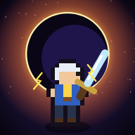

# ☀️ ÉCLIPSIA ☾
### *Les Gardiens de l'Aube*

**Un RPG d'action mobile dans la lignée d'Inotia 4, dans un univers entièrement original.**

[](https://github.com/Nicki24/Game/releases/latest/download/Eclipsia.apk)
[](https://nicki24.github.io/Game/)

-ffd84a?style=flat-square)


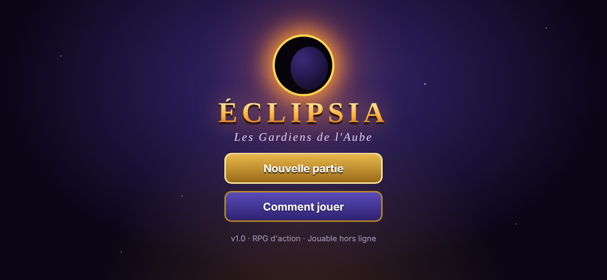

</div>

---

## 📑 Sommaire

- [📲 Télécharger et installer](#-télécharger-et-installer)
- [📖 L'histoire](#-lhistoire)
- [⚔️ Les quatre classes](#️-les-quatre-classes)
- [🤝 Les compagnons](#-les-compagnons)
- [🗺️ Le monde de Valdris](#️-le-monde-de-valdris)
- [🎮 Système de jeu](#-système-de-jeu)
- [✨ Ce qui nous différencie d'Inotia 4](#-ce-qui-nous-différencie-dinotia-4)
- [🕹️ Commandes](#️-commandes)
- [🖼️ Galerie](#️-galerie)
- [🛠️ Côté technique](#️-côté-technique)
- [🧑‍💻 Développer et modifier le jeu](#-développer-et-modifier-le-jeu)
- [🗓️ Feuille de route](#️-feuille-de-route)

---

## 📲 Télécharger et installer

### Android (APK)

> ### 👉 [**Télécharger Eclipsia.apk**](https://github.com/Nicki24/Game/releases/latest/download/Eclipsia.apk)
> *Ce lien pointe toujours vers la toute dernière version.*

1. Ouvrez le lien ci-dessus **depuis votre téléphone Android**.
2. Une fois le fichier téléchargé, touchez-le pour l'ouvrir.
3. Si Android affiche *« Pour votre sécurité, votre téléphone n'est pas autorisé à installer des applications inconnues »*, touchez **Paramètres** puis activez **Autoriser cette source**, et revenez en arrière.
4. Touchez **Installer**, puis **Ouvrir**. Bonne aventure, Gardien ! ⚔️

> 💡 **Mises à jour :** téléchargez simplement le nouvel APK et installez-le par-dessus : votre sauvegarde est conservée.
>
> 🔧 L'APK est compilé automatiquement par GitHub Actions à chaque modification du jeu. Toutes les versions sont listées dans l'onglet [**Releases**](https://github.com/Nicki24/Game/releases).

### iPhone / iPad / PC (version web)

Le jeu tourne aussi dans n'importe quel navigateur moderne : **[nicki24.github.io/Game](https://nicki24.github.io/Game/)**

- **iPhone / iPad :** ouvrez le lien dans Safari → bouton *Partager* → **Sur l'écran d'accueil**. Le jeu s'installe comme une vraie application, en plein écran et **jouable hors ligne**.
- **PC :** jouez au clavier (voir [Commandes](#️-commandes)).
- **Hors ligne sans Internet :** téléchargez `Eclipsia-web.zip` depuis les [Releases](https://github.com/Nicki24/Game/releases), décompressez-le et ouvrez `index.html`.

> ℹ️ Si le lien web ne répond pas encore : dans le dépôt GitHub, allez dans **Settings → Pages → Source** et choisissez **GitHub Actions** (une seule fois). Le jeu se publiera tout seul ensuite.

---

## 📖 L'histoire

> *Il y a mille ans, le **Cœur d'Aube** brillait au sommet du monde. Sa lumière maintenait dans le ciel **l'archipel de Valdris**, des îles flottant au-dessus d'une mer de nuages.*
>
> *Mais **Morvane**, un mage obsédé par l'immortalité, voulut boire sa lumière. Le Cœur se brisa en cinq fragments… Depuis cette nuit appelée **la Grande Fracture**, une éclipse s'étend lentement et les îles s'enfoncent dans le Néant.*
>
> *Les fragments ont corrompu les gardiens qui les protégeaient. Au village d'**Aubeclair**, l'Oracle **Séléné** a vu un signe dans les étoiles : un **Gardien de l'Aube** vient de s'éveiller.*
>
> ***C'est vous.***

Votre quête : parcourir les cinq régions de Valdris, vaincre les gardiens corrompus, réunir les fragments… et affronter Morvane dans la **Citadelle de l'Éclipse** pour rallumer l'aube.

| Chapitre | Quête | Fragment |
|:---:|---|---|
| I | **L'Éveil du Gardien** — purifier la Forêt de Sylvebrume | 🌿 Fragment de Sève |
| II | **Le Feu sous la Montagne** — descendre dans les Mines de Cendrefer | 🔥 Fragment de Braise |
| III | **Les Larmes de la Lune** — briser l'hiver du Lac de Givrelune | ❄️ Fragment de Givre |
| IV | **Le Réveil du Colosse** — explorer les Ruines Solaires | ⚡ Fragment d'Orage |
| V | **L'Éclipse Éternelle** — affronter Morvane | ☀️ Cœur d'Aube |

---

## ⚔️ Les quatre classes

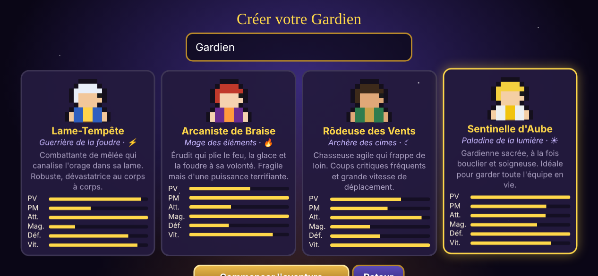

| Classe | Rôle | Élément | Compétences (rang 1 → 5) |
|---|---|:---:|---|
| ⚡ **Lame-Tempête** | Guerrière de mêlée, robuste | Foudre | Tranche-Foudre · Tourbillon d'Acier · Charge Orageuse · Cri du Titan |
| 🔥 **Arcaniste de Braise** | Mage à distance, très puissant mais fragile | Feu / Glace / Foudre | Boule de Braise · Lance de Givre · Pluie de Météores · Chaîne d'Éclairs |
| 🏹 **Rôdeuse des Vents** | Archère rapide, critiques fréquents | Ombre | Tir Perçant · Volée de Flèches · Piège d'Ombre · Danse du Vent |
| ☀️ **Sentinelle d'Aube** | Paladine : tank + soins | Lumière | Frappe Sacrée · Prière d'Aube · Jugement Céleste · Égide d'Aube |

Chaque classe a son **arme propre** (épée, bâton, arc, masse), ses statistiques et sa façon de jouer. Les compétences se débloquent aux niveaux 1, 3, 6 et 10 et s'améliorent avec **1 point de compétence par niveau** (niveau maximum : 30).

---

## 🤝 Les compagnons

Comme dans Inotia, vous partez à l'aventure avec **jusqu'à 2 mercenaires** recrutés à la **Taverne de l'Étoile Filante**. Ils gagnent des niveaux avec vous, utilisent leur propre compétence et ont chacun leur intelligence artificielle.

| Compagnon | Race | Rôle | Compétence | Disponible |
|---|---|---|---|---|
| 🛡️ **Brom Cœur-d'Enclume** | Nain | Protecteur : attire les ennemis sur lui | *Provocation* | Dès le début |
| 🌿 **Lysa Feuillelune** | Elfe | Soigneuse : soigne l'allié le plus blessé | *Souffle de Vie* | Après le chapitre I |
| 🗡️ **Kaïra Lame-Nocturne** | Humaine | Assassine : vitesse et critiques | *Lames Ombrales* | Après le chapitre II |
| ⚙️ **Pip Rouage** | Gnome | Mécanomancien : arcs électriques | *Arc Tesla* | Après le chapitre III |

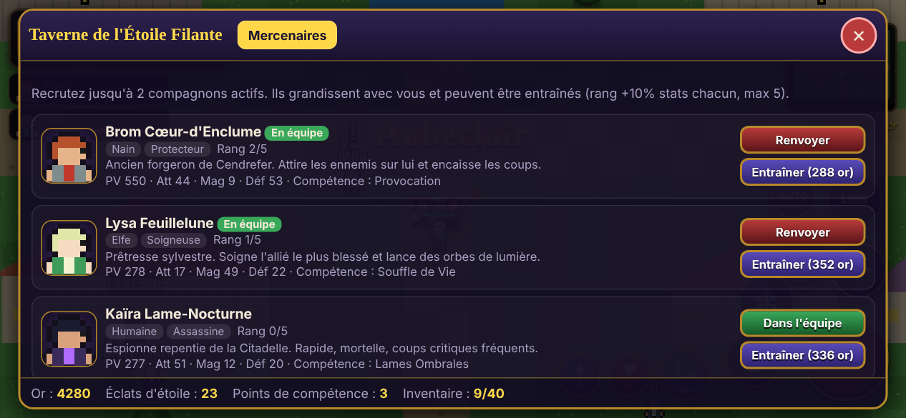

---

## 🗺️ Le monde de Valdris

| Zone | Niveaux | Ambiance | Monstres | Boss |
|---|:---:|---|---|---|
| 🏘️ **Aubeclair** | — | Village-refuge : oracle, boutique, forge, taverne, portail | — | — |
| 🌲 **Forêt de Sylvebrume** | 1 – 6 | Bois brumeux | Gluant de Brume, Loup-Brume, Sporelin | 🌳 **Racine-Noire**, Gardien Corrompu |
| ⛏️ **Mines de Cendrefer** | 6 – 11 | Galeries de braise | Gobelin Mineur, Chauve-Souris de Braise, Golem de Cendre | 🔥 **Kragg**, le Forgeur Déchu |
| 🧊 **Lac de Givrelune** | 11 – 16 | Lac gelé en plein été | Esprit de Givre, Loup de Givrelune, Yéti | ❄️ **Nivara**, Reine Glaciale |
| 🏜️ **Ruines Solaires** | 16 – 21 | Désert de verre et temples | Scorpion de Verre, Momie Foudroyée, Gardien des Ruines | ⚡ **Colosse d'Orage** |
| 🏰 **Citadelle de l'Éclipse** | 21 – 26 | Forteresse du Néant | Chevalier de l'Éclipse, Spectre du Néant, Chien du Néant | 👑 **Morvane**, Souverain du Néant (2 phases) |

**20 créatures** au total, toutes répertoriées dans le **Bestiaire** avec leurs faiblesses élémentaires.

---

## 🎮 Système de jeu

- **Combat en temps réel** avec ciblage automatique : maintenez le bouton d'attaque, votre héros va vers l'ennemi le plus proche et frappe.
- **Monstres normaux, d'élite et boss.** Les boss ont des attaques télégraphiées (zones rouges au sol), des invocations, des charges, des anneaux de projectiles et un mode **enragé** sous 50 % de vie.
- **Butin aléatoire** en 5 raretés : <span>Commun</span> ⚪ · Magique 🔵 · Rare 🟡 · Héroïque 🟣 · Légendaire 🟠, avec des bonus aléatoires (attaque, magie, défense, PV, PM, critique, vitesse).
- **Armes enchantées :** une arme rare ou mieux peut porter un élément — vos attaques de base en prennent la couleur et le pouvoir.
- **Quêtes** principales (5 chapitres) et **secondaires** (6 quêtes de chasse et de collecte) avec marqueurs **!** et **?** au-dessus des personnages.
- **Boutique** (potions, parchemins, équipement du jour), **vente** et **forge**.
- **4 emplacements d'équipement :** arme, armure, casque, talisman. Les objets meilleurs que les vôtres sont signalés par une flèche verte ▲.
- **Mini-carte** avec brouillard de guerre, barre de vie du boss, chiffres de dégâts, compteur de combo.
- **Sauvegarde automatique** (toutes les 20 secondes et à chaque événement important).

---

## ✨ Ce qui nous différencie d'Inotia 4

| Nouveauté | Description |
|---|---|
| 🌅 **Lien d'Aube** | Une jauge se remplit en combattant. Une fois pleine, **toute l'équipe** déclenche une attaque combinée dévastatrice qui soigne aussi le groupe. Plus vous avez de compagnons, plus elle est forte. |
| ⤿ **Esquive** | Une roulade avec invincibilité pour éviter les attaques des boss. Le combat récompense les réflexes, pas seulement les statistiques. |
| 🔥 **Cycle élémentaire** | Feu > Nature > Foudre > Glace > Feu, et Lumière ⇄ Ombre. Exploiter une faiblesse fait **×1,5** dégâts (« FAIBLE ! »). |
| 🌗 **Cycle jour / nuit** | La nuit tombe toutes les 5 minutes : les monstres deviennent **20 % plus forts** mais rapportent **25 % d'expérience** en plus. Une lumière vous entoure dans l'obscurité. |
| 🔥 **Combos** | Enchaînez les coups pour monter jusqu'à **+30 % de dégâts**. |
| 🤖 **Combat automatique** | Le bouton AUTO laisse votre héros attaquer, lancer ses sorts et boire ses potions tout seul. |
| ⚒️ **Forge sans risque** | Renforcement jusqu'à **+10**. Un échec ne détruit **jamais** votre objet, et le **recyclage** transforme l'équipement inutile en Éclats d'étoile. |
| 🗺️ **Donjons générés** | Chaque visite d'une zone crée une nouvelle carte : jamais deux fois la même exploration. |
| 🧲 **Butin magnétique** | Plus besoin de ramasser : l'or et les objets viennent à vous. |
| 💚 **Potions d'équipe** | Une potion de vie soigne **tout le groupe**, et les compagnons tombés se relèvent seuls après 15 secondes. |
| 📈 **Entraînement des compagnons** | Montez le rang de vos mercenaires à la taverne (+10 % de statistiques par rang). |
| 📚 **Bestiaire** | Toutes les créatures rencontrées, leur élément, leurs faiblesses et votre nombre de victoires. |
| 🎵 **Zéro fichier externe** | Graphismes pixel-art et musiques **générés par le code** : le jeu pèse quelques centaines de Ko et fonctionne hors ligne. |

---

## 🕹️ Commandes

### 📱 Écran tactile

| Contrôle | Action |
|---|---|
| **Moitié gauche de l'écran** | Joystick virtuel : se déplacer |
| ⚔️ **Gros bouton rouge** | Attaquer (maintenir) — devient **Parler / Voyager** au village |
| **4 boutons ronds** | Compétences (le coût en PM et la recharge sont affichés) |
| ⤿ **Esquive** | Roulade d'invincibilité |
| **LIEN** | Attaque combinée (quand il brille) |
| **AUTO** | Combat automatique |
| ♥ / ✦ | Potion de vie / de mana |
| ☰ | Menu : équipement, compétences, quêtes, équipe, bestiaire, options |

### ⌨️ Clavier (PC)

| Touche | Action |
|---|---|
| `ZQSD` / `WASD` / flèches | Se déplacer |
| `J` ou `Espace` | Attaquer / parler |
| `1` `2` `3` `4` | Compétences |
| `K` ou `Maj` | Esquive |
| `L` | Lien d'Aube |
| `R` / `E` | Potion de vie / de mana |
| `F` | Interagir |
| `T` | Combat automatique |
| `M` ou `Échap` | Menu |

---

## 🖼️ Galerie

<table>
<tr>
<td width="50%">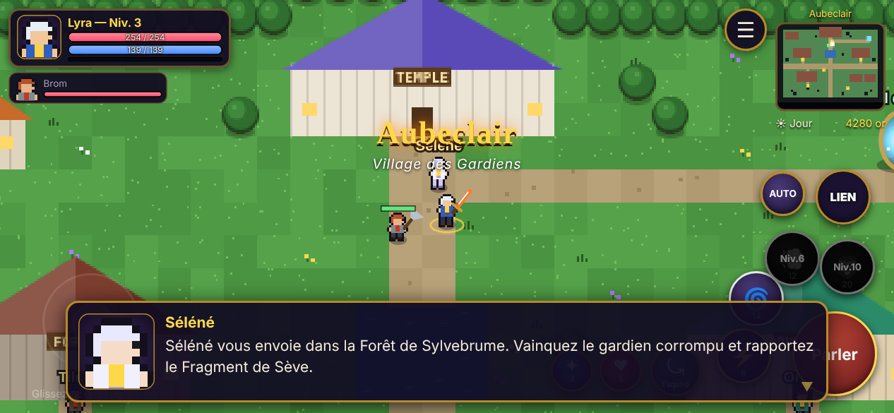<br><sub>🏘️ Aubeclair — l'Oracle Séléné confie la première mission</sub></td>
<td width="50%">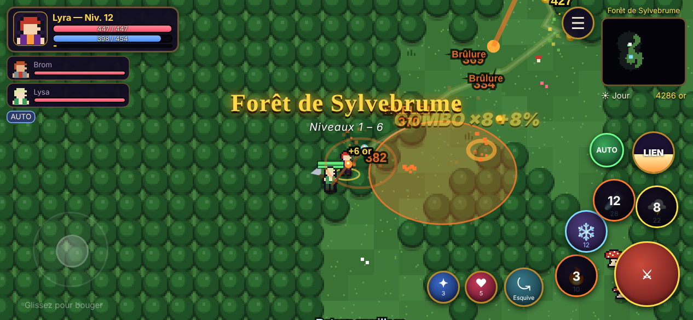<br><sub>☄️ Pluie de Météores de l'Arcaniste dans la Forêt de Sylvebrume</sub></td>
</tr>
<tr>
<td>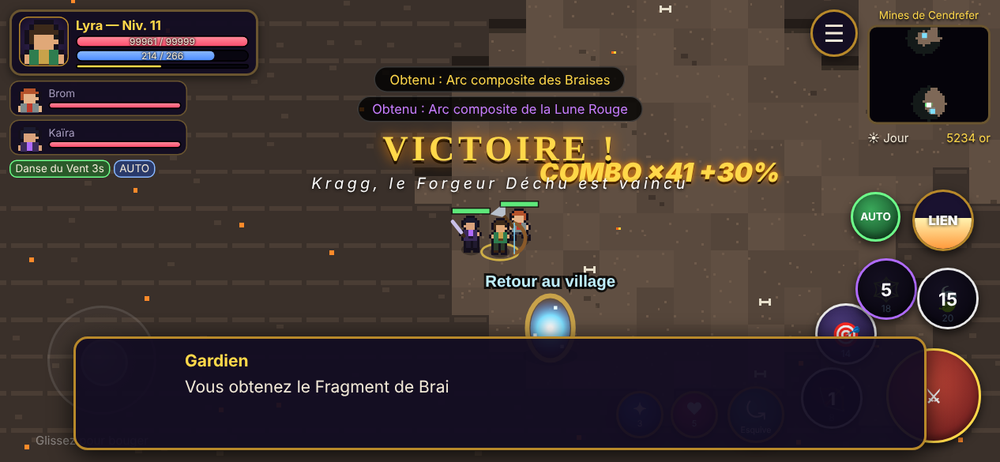<br><sub>🔥 Victoire contre Kragg, le Forgeur Déchu</sub></td>
<td>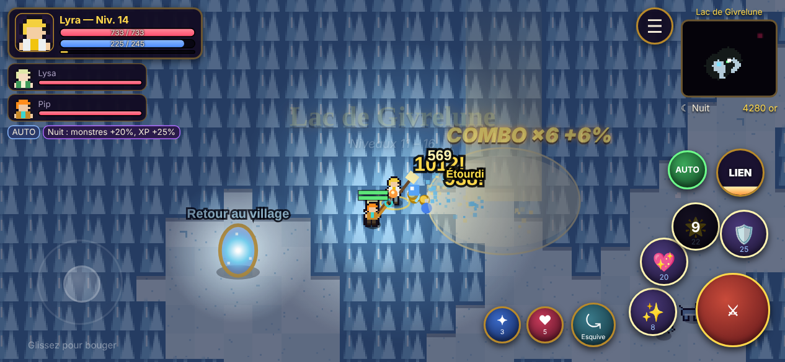<br><sub>🌙 La nuit tombe sur le Lac de Givrelune</sub></td>
</tr>
<tr>
<td>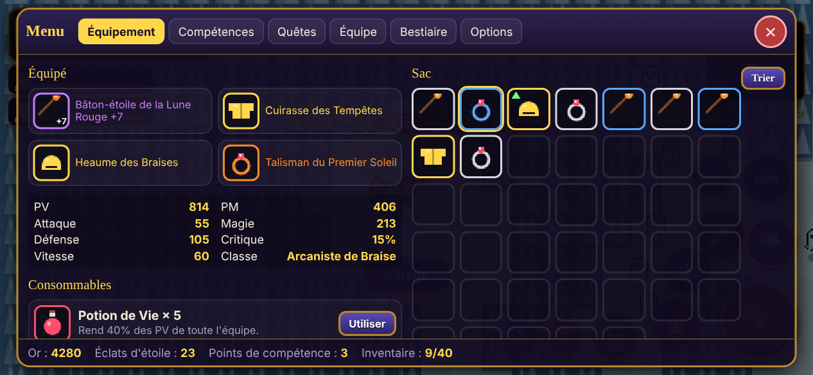<br><sub>🎒 Équipement, raretés et comparaison des objets</sub></td>
<td>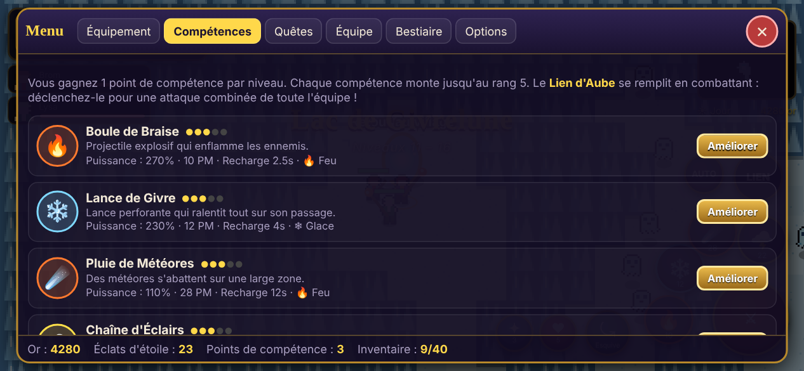<br><sub>📜 Arbre de compétences</sub></td>
</tr>
<tr>
<td>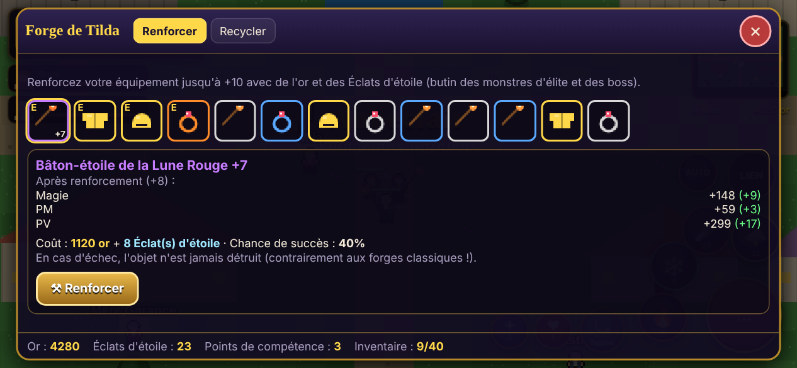<br><sub>⚒️ La forge de Tilda : renforcement jusqu'à +10</sub></td>
<td>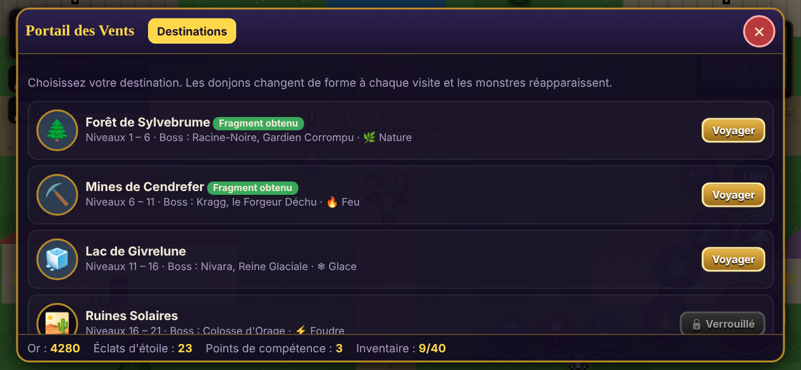<br><sub>🌀 Le Portail des Vents vers les cinq régions</sub></td>
</tr>
<tr>
<td colspan="2">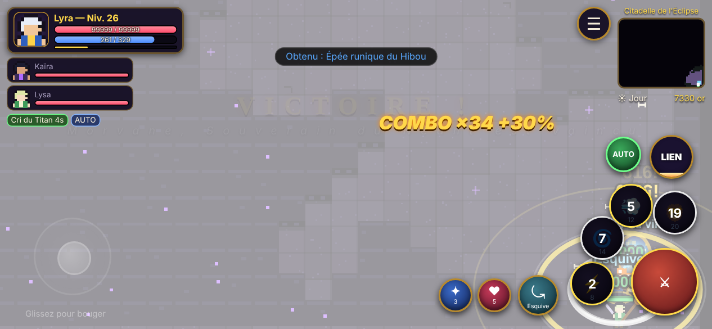<br><sub>👑 Le combat final contre Morvane, Souverain du Néant</sub></td>
</tr>
</table>

---

## 🛠️ Côté technique

Éclipsia est écrit en **JavaScript pur** (aucun framework, aucune image ni fichier audio) et affiché dans un **Canvas HTML5**. Pour Android, il est empaqueté dans une application native avec **[Capacitor](https://capacitorjs.com/)**.

```
Game/
├── www/                      ← le jeu complet (c'est ce qui est installé sur le téléphone)
│   ├── index.html            ← structure de l'interface (HUD, boutons, menus)
│   ├── css/style.css         ← style de l'interface
│   ├── manifest.webmanifest  ← installation en application web (PWA)
│   ├── sw.js                 ← service worker : jeu jouable hors ligne
│   ├── icons/                ← icônes de l'application
│   └── js/
│       ├── data.js           ← 📖 TOUT l'univers : classes, compétences, monstres, zones, quêtes, dialogues
│       ├── game.js           ← boucle de jeu, zones, quêtes, butin, niveaux, sauvegarde
│       ├── combat.js         ← dégâts, éléments, compétences, IA des monstres / compagnons / boss
│       ├── render.js         ← affichage : carte, personnages, lumière jour/nuit
│       ├── sprites.js        ← pixel-art procédural (personnages, monstres, décors, icônes)
│       ├── world.js          ← génération des cartes (village + donjons aléatoires)
│       ├── items.js          ← objets, raretés, forge, recyclage
│       ├── ui.js             ← HUD, dialogues, menus, boutique, forge, taverne
│       ├── input.js          ← joystick tactile et clavier
│       ├── fx.js             ← effets visuels (particules, éclairs, météores…)
│       ├── audio.js          ← sons et musiques synthétisés en temps réel
│       └── util.js           ← outils (aléatoire, maths)
├── android-res/              ← icônes Android
├── tools/                    ← génération des icônes, clé de signature commune des APK
├── docs/screenshots/         ← captures d'écran du README
├── capacitor.config.json     ← configuration de l'application Android
└── .github/workflows/
    ├── android.yml           ← 🤖 compile l'APK et publie la Release automatiquement
    └── pages.yml             ← 🌐 publie la version web sur GitHub Pages
```

### Comment l'APK est fabriqué

À chaque modification poussée sur GitHub, le workflow **« Construire l'APK Android »** :
1. installe Node.js, Java 21 et Capacitor ;
2. génère le projet Android, ajoute les icônes, force le **plein écran** et l'orientation **paysage** ;
3. compile `Eclipsia.apk` avec Gradle ;
4. publie une **Release** GitHub `v1.0.N` contenant l'APK et la version web zippée.

Le lien [`releases/latest/download/Eclipsia.apk`](https://github.com/Nicki24/Game/releases/latest/download/Eclipsia.apk) pointe donc toujours vers la dernière version.

---

## 🧑‍💻 Développer et modifier le jeu

**Jouer en local** (aucune installation nécessaire hormis Python ou Node.js) :

```bash
git clone https://github.com/Nicki24/Game.git
cd Game
python3 -m http.server 8080 --directory www   # ou : npm start
# puis ouvrez http://localhost:8080
```

**Modifier l'univers** : presque tout se trouve dans [`www/js/data.js`](www/js/data.js). Par exemple, pour créer un nouveau monstre, ajoutez une entrée dans `MONSTERS` (gabarit de sprite, couleurs, élément, multiplicateurs de stats) et ajoutez son identifiant dans la liste `mobs` d'une zone. Les dialogues, quêtes, compétences et compagnons se modifient de la même façon.

**Compiler l'APK sur votre ordinateur** (nécessite Android Studio / le SDK Android et Java 21) :

```bash
npm install
npx cap add android
npx cap sync android
cd android && ./gradlew assembleDebug
# APK : android/app/build/outputs/apk/debug/app-debug.apk
```

> 🔐 Les APK sont signés avec une clé de développement commune (`tools/debug.keystore`) pour que chaque mise à jour s'installe par-dessus la précédente. Pour une publication sur le Google Play Store, il faudra créer votre propre clé de signature privée.

---

## 🗓️ Feuille de route

- [x] 4 classes jouables, 16 compétences, 4 compagnons
- [x] 5 régions + village, 20 monstres dont 5 boss
- [x] Quêtes principales et secondaires, boutique, forge, taverne
- [x] Lien d'Aube, esquive, éléments, jour/nuit, combos, combat automatique
- [x] APK Android automatique + version web hors ligne
- [ ] Mode Nouvelle Partie+ (difficulté accrue après la fin)
- [ ] Familiers (pets) qui ramassent le butin et donnent des bonus
- [ ] Panoplies d'équipement avec bonus d'ensemble
- [ ] Donjon infini « Tour du Néant » avec classement

---

<div align="center">

**Éclipsia** — univers, histoire, personnages, graphismes et musiques créés pour ce projet.
<br>Inspiré par l'esprit des RPG d'action mobiles comme *Inotia 4* (Com2uS), sans en reprendre le contenu.

☀️ *Que l'aube te guide, Gardien.* ☾

</div>
